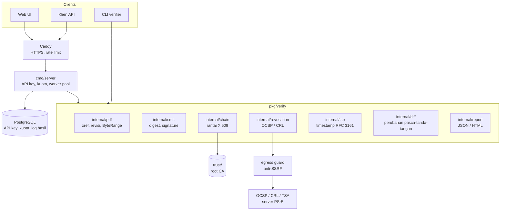

# Technical Design — PDF Signature Verifier

| | |
|---|---|
| **Status** | Draft v0.1 |
| **Pemilik** | Nur Yanfa |
| **Terakhir diperbarui** | 2026-10-24 |
| **Dokumen terkait** | [prd.md](prd.md) · [threat-model.md](threat-model.md) · [adr/](adr/) · [api/openapi.yaml](api/openapi.yaml) |

---

## 1. Gambaran umum

Seluruh logika verifikasi berada di library `pkg/verify`. Tiga antarmuka memakai library yang sama:



**Prinsip desain**

1. **Inti tanpa efek samping.** `pkg/verify` tidak menyimpan file, tidak menulis log berisi isi dokumen, dan semua akses jaringan lewat interface yang bisa diganti (untuk test dan mode offline).
2. **Fail closed.** Jika sesuatu tidak bisa dipastikan, hasilnya `INDETERMINATE`, tidak pernah `PASSED`.
3. **Jangan menulis kriptografi sendiri.** Parsing PDF boleh ditulis sendiri bila perlu; primitif kriptografi selalu dari stdlib atau library yang sudah diaudit komunitas.
4. **Setiap temuan punya kode.** Kode stabil dipakai di laporan, test, dan dokumentasi.

## 2. Struktur repo

```
cmd/
  verifier/            # CLI (main.go, flag parsing, format output)
  server/              # HTTP server (API + web UI)
pkg/verify/            # API publik library
internal/
  pdf/                 # tokenizer, xref, revisi, signature dictionary, ByteRange
  cms/                 # parse CMS, cek messageDigest, verifikasi signature
  chain/               # bangun & validasi rantai, trust store loader
  revocation/          # klien OCSP, CRL, cache
  egress/              # http.Client dengan guard anti-SSRF
  tsp/                 # verifikasi timestamp token RFC 3161
  diff/                # klasifikasi incremental update, DocMDP
  report/              # model hasil, kode temuan, render JSON/HTML
  server/              # handler, middleware, auth, rate limit
  store/               # akses PostgreSQL (fase komersial)
web/
  templates/           # html/template
  static/              # CSS, htmx
trust/
  roots/               # *.pem
  manifest.yaml        # sumber, fingerprint, tanggal ambil
testdata/
  corpus/              # PDF uji + expected.json per kasus
  pki/                 # generator CA tiruan, OCSP responder tiruan
docs/
deploy/
  docker-compose.yml
  Caddyfile
  setup-vm.sh
.github/workflows/
```

Aturan dependensi: `cmd/*` → `pkg/verify` → `internal/*`. Paket `internal/*` tidak saling mengimpor kecuali `report` (dipakai semua) dan `egress` (dipakai `revocation`, `tsp`).

## 3. API publik library

```go
package verify

type Options struct {
    TrustStore    *TrustStore      // wajib; LoadTrustStore(dir) atau DefaultTrustStore()
    Revocation    RevocationMode   // Online (default) atau Offline
    AllowOfflinePass bool          // hanya CLI/test: izinkan PASSED tanpa cek revocation
    HTTPClient    Fetcher          // default: egress-guarded client
    Now           func() time.Time // untuk test
    Limits        Limits
}

type Limits struct {
    MaxFileBytes    int64         // default 20 MiB
    MaxSignatures   int           // default 50
    MaxObjects      int           // default 200_000
    Timeout         time.Duration // default 15s
}

// Verify memeriksa seluruh tanda tangan pada dokumen.
// Error hanya dikembalikan untuk kegagalan sistem (misalnya context dibatalkan).
// Dokumen yang rusak atau tidak valid TIDAK menghasilkan error, melainkan Report berstatus FAILED/INDETERMINATE.
func Verify(ctx context.Context, r io.ReaderAt, size int64, opt Options) (*Report, error)
```

Keputusan: `io.ReaderAt` + `size`, bukan path, agar server bisa memproses dari memori dan CLI dari file tanpa kode berbeda.

## 4. Pipeline verifikasi

Untuk setiap dokumen:

```
0. Batasi ukuran, set deadline dari Limits.Timeout
1. pdf.Parse          → revisi (xref sections), daftar signature field
2. hitung SHA-256 dokumen
3. untuk setiap tanda tangan (urut berdasarkan revisi):
   3.1 pdf.ByteRange      → validasi struktur ByteRange (FR-2.4, FR-2.5)
   3.2 cms.Parse          → SignedData, signer info, sertifikat tertanam
   3.3 cms.CheckDigest    → digest(ByteRange) == messageDigest
   3.4 cms.VerifySig      → signature atas signedAttrs valid
   3.5 tsp.Verify         → jika ada signature timestamp, tentukan waktu terpercaya
   3.6 chain.Build        → rantai ke root di trust store, cek validity pada waktu tanda tangan, key usage
   3.7 revocation.Check   → OCSP → CRL, untuk setiap sertifikat non-root di rantai
   3.8 diff.After         → klasifikasi revisi setelah tanda tangan ini, cek DocMDP
   3.9 tentukan status tanda tangan (§5)
4. tentukan status dokumen (§5)
5. report.Build
```

Langkah 3.x dijalankan berurutan per tanda tangan; antar tanda tangan boleh paralel (dibatasi semaphore) karena revocation adalah bagian paling lambat.

## 5. Penentuan status

Mengikuti model ETSI EN 319 102-1: tiga status utama dengan sub-indikasi. Aturan diterapkan berurutan; aturan pertama yang cocok menentukan status.

### Status per tanda tangan

| # | Kondisi | Status | Sub-indikasi |
|---|---|---|---|
| 1 | ByteRange tidak valid atau tidak menutupi file sesuai FR-2.4 | TOTAL-FAILED | `FORMAT_FAILURE` |
| 2 | Digest tidak cocok | TOTAL-FAILED | `HASH_FAILURE` |
| 3 | Signature kriptografis tidak valid | TOTAL-FAILED | `SIG_CRYPTO_FAILURE` |
| 4 | Sertifikat dicabut **sebelum** waktu tanda tangan | TOTAL-FAILED | `REVOKED` |
| 5 | Perubahan pasca-tanda-tangan melanggar DocMDP, atau mengubah konten halaman | TOTAL-FAILED | `MODIFIED_AFTER_SIGNING` (kode internal) |
| 6 | Rantai tidak sampai ke root di trust store | INDETERMINATE | `NO_CERTIFICATE_CHAIN_FOUND` |
| 7 | Sertifikat kedaluwarsa pada waktu tanda tangan terpercaya | INDETERMINATE | `OUT_OF_BOUNDS_NO_POE` |
| 8 | Status revocation tidak bisa diperoleh | INDETERMINATE | `TRY_LATER` / `REVOCATION_UNAVAILABLE` |
| 9 | Algoritma lemah (MD5, SHA-1 untuk signature, RSA < 2048) | INDETERMINATE | `CRYPTO_CONSTRAINTS_FAILURE` |
| 10 | Semua lolos | TOTAL-PASSED | — |

Catatan:
- Sertifikat yang dicabut **setelah** waktu tanda tangan terpercaya (dibuktikan timestamp) tidak menggagalkan tanda tangan; dilaporkan sebagai peringatan.
- Tanpa timestamp, "waktu tanda tangan" = `signingTime` yang diklaim penanda tangan, dan laporan menandainya `claimed`.
- Mode `Offline`: aturan 8 menghasilkan peringatan `REVOCATION_SKIPPED`, dan status maksimal `INDETERMINATE` kecuali opsi `AllowOfflinePass` diaktifkan eksplisit (khusus CLI/test).

### Status dokumen

- Ada tanda tangan `TOTAL-FAILED` → dokumen `TOTAL-FAILED`.
- Ada tanda tangan `INDETERMINATE` → dokumen `INDETERMINATE`.
- Tidak ada tanda tangan → `INDETERMINATE` dengan `NO_SIGNATURE`.
- Selain itu → `TOTAL-PASSED`.

## 6. Deteksi perubahan pasca-tanda-tangan (`internal/diff`)

Ini pembeda utama produk. Tujuannya menangkap incremental saving attack dan memberi penjelasan, tanpa harus merender halaman.

**Langkah**

1. Dari xref, petakan setiap revisi `R0..Rn` ke rentang byte.
2. Tanda tangan `S` berada di revisi `Rk` (revisi tempat `ByteRange`-nya berakhir).
3. Untuk setiap revisi `Rj` dengan `j > k`, kumpulkan objek baru/diubah.
4. Klasifikasikan setiap objek:

| Kelas | Contoh objek | Dampak default |
|---|---|---|
| `SIGNATURE` | Field `/Sig` baru, `/DSS`, `/DocTimeStamp` | Diizinkan |
| `FORM_FILL` | Nilai `/V` pada field form yang sudah ada | Diizinkan jika DocMDP P ≥ 2 atau tidak ada DocMDP |
| `ANNOTATION` | Anotasi komentar baru | Diizinkan jika DocMDP P = 3 atau tidak ada DocMDP, tetapi dilaporkan |
| `CONTENT` | `/Contents` halaman, `/Resources`, font, XObject, `/Pages`, `/Root` selain yang di atas | **Ditolak** |
| `UNKNOWN` | Objek yang tidak bisa diklasifikasikan | Peringatan, status minimal INDETERMINATE |

5. Jika ada objek kelas `CONTENT` setelah tanda tangan, atau objek yang melanggar izin DocMDP, hasilkan `MODIFIED_AFTER_SIGNING` dengan daftar objek dan revisi.

**Batasan yang disadari (dicatat di README)**
- Shadow attack jenis *hide* dan *replace* bisa memakai objek yang sudah disiapkan sebelum penandatanganan. Deteksi penuh butuh render dan perbandingan visual antar-revisi; ini **P1**, bukan MVP.
- Klasifikasi objek memakai heuristik konservatif: lebih baik peringatan palsu daripada lolos palsu.

## 7. Trust store (`trust/`)

```yaml
# trust/manifest.yaml
version: 2026-10-24
roots:
  - file: roots/root-ca-ri.pem
    name: "Root CA Indonesia (contoh)"
    sha256: "<fingerprint>"
    source: "<URL resmi tempat sertifikat diambil>"
    fetched_at: 2026-10-24
    notes: ""
```

- Saat startup, loader memverifikasi setiap file terhadap `sha256` di manifest. Mismatch = gagal start.
- Perubahan `trust/` wajib lewat pull request dengan sumber yang bisa dicek ([ADR-0005](adr/0005-trust-store-curated.md)).
- Versi manifest dicantumkan di setiap laporan.

## 8. Revocation dan egress guard

**Urutan:** OCSP dari AIA → jika gagal/tidak ada, CRL dari CDP → jika gagal, `REVOCATION_UNAVAILABLE`.

**Cache:** in-memory LRU, kunci = (issuer key hash, serial), TTL = `nextUpdate` dibatasi maksimal 24 jam. CRL di-cache per URL.

**Egress guard** (`internal/egress`), semua aturan wajib:
- Hanya skema `http` dan `https`.
- Resolve DNS sendiri, tolak IP privat, loopback, link-local (termasuk `169.254.169.254`), CGNAT, multicast, dan IPv6 setara. Koneksi memakai IP hasil resolve (mencegah DNS rebinding).
- Port hanya 80 dan 443.
- Maksimal 2 redirect, setiap hop dicek ulang.
- Batas respons: OCSP 64 KiB, CRL 10 MiB.
- Timeout per request 5 detik.

Detail ancaman di [threat-model.md](threat-model.md); keputusan di [ADR-0004](adr/0004-egress-guard.md).

## 9. Model laporan

Skema JSON berversi (`schema_version`). Contoh:

```json
{
  "schema_version": "1.0",
  "verification_id": "vrf_01JB8Z3K9Q2X7M4T6N5R",
  "verified_at": "2026-10-24T14:02:11Z",
  "verifier_version": "0.3.0",
  "trust_store_version": "2026-10-24",
  "document": {
    "sha256": "9f2c…",
    "size_bytes": 482113,
    "revisions": 3
  },
  "status": "TOTAL-FAILED",
  "sub_indication": "MODIFIED_AFTER_SIGNING",
  "summary": {
    "id": "Isi dokumen diubah setelah ditandatangani.",
    "en": "The document content was changed after it was signed."
  },
  "signatures": [
    {
      "index": 0,
      "field_name": "Signature1",
      "revision": 1,
      "status": "TOTAL-FAILED",
      "sub_indication": "MODIFIED_AFTER_SIGNING",
      "signer": {
        "common_name": "Budi Santoso",
        "organization": "PT Contoh",
        "serial": "4A:1F:…"
      },
      "signing_time": { "value": "2026-10-20T03:15:00Z", "source": "timestamp" },
      "chain": [
        { "subject": "CN=Budi Santoso", "issuer": "CN=PSrE Contoh CA", "not_after": "2027-10-01T00:00:00Z" },
        { "subject": "CN=PSrE Contoh CA", "issuer": "CN=Root CA", "not_after": "2031-01-01T00:00:00Z" }
      ],
      "revocation": { "method": "OCSP", "status": "good", "produced_at": "2026-10-24T14:02:10Z" },
      "byte_range": { "covers_whole_revision": true },
      "findings": [
        {
          "code": "MODIFIED_AFTER_SIGNING",
          "severity": "critical",
          "message": { "id": "Revisi 2 mengubah isi halaman 3.", "en": "Revision 2 modifies the content of page 3." },
          "details": { "revision": 2, "objects": ["12 0 R", "15 0 R"], "class": "CONTENT" }
        }
      ]
    }
  ]
}
```

Daftar lengkap kode temuan dipelihara di `internal/report/codes.go` dan diekspor ke `docs/finding-codes.md` lewat `go generate`.

## 10. Server HTTP

| Endpoint | Method | Auth | Keterangan |
|---|---|---|---|
| `/` | GET | — | Halaman upload |
| `/verify` | POST | — | Form upload web, render HTML hasil |
| `/v1/verify` | POST | API key (opsional di MVP, kuota rendah tanpa key) | Multipart `file`, query `format=json|html`, `revocation=online|offline` |
| `/v1/trust` | GET | — | Versi dan daftar root CA |
| `/healthz` | GET | — | Liveness |
| `/readyz` | GET | — | Trust store termuat, DB terhubung (jika dipakai) |
| `/metrics` | GET | Hanya dari jaringan internal | Prometheus |

Spesifikasi lengkap: [api/openapi.yaml](api/openapi.yaml).

**Middleware (urut):** request ID → recover panic → limit body (`http.MaxBytesReader`) → rate limit (per IP, per API key) → auth → timeout → handler.

**Konkurensi:** worker pool berukuran `VERIFIER_WORKERS` (default = jumlah vCPU). Request yang tidak mendapat slot dalam 2 detik ditolak `503` dengan `Retry-After`, agar VM tidak kehabisan memori.

**Penanganan file:** body dibaca ke memori (maksimal 20 MiB) sebagai `bytes.Reader` lalu dibuang setelah respons. Tidak ada file sementara.

## 11. Konfigurasi

Semua lewat environment variable:

| Variabel | Default | Keterangan |
|---|---|---|
| `VERIFIER_ADDR` | `:8080` | Alamat listen |
| `VERIFIER_TRUST_DIR` | `/app/trust` | Lokasi trust store |
| `VERIFIER_WORKERS` | `runtime.NumCPU()` | Ukuran worker pool |
| `VERIFIER_MAX_FILE_MB` | `20` | Batas ukuran file |
| `VERIFIER_TIMEOUT` | `15s` | Timeout per verifikasi |
| `VERIFIER_RATE_ANON` | `10/h` | Kuota tanpa API key per IP |
| `VERIFIER_DATABASE_URL` | kosong | Jika kosong, fitur API key dimatikan |
| `VERIFIER_LOG_LEVEL` | `info` | |

## 12. Data (fase komersial)

PostgreSQL hanya menyimpan metadata. Tidak ada kolom untuk isi dokumen.

```sql
create table api_keys (
  id          uuid primary key,
  name        text not null,
  key_hash    bytea not null unique,   -- SHA-256 dari key; key mentah hanya ditampilkan sekali
  quota_month integer not null,
  created_at  timestamptz not null default now(),
  revoked_at  timestamptz
);

create table verifications (
  id            text primary key,        -- verification_id
  api_key_id    uuid references api_keys(id),
  doc_sha256    bytea not null,
  status        text not null,
  sub_indication text,
  duration_ms   integer not null,
  created_at    timestamptz not null default now()
);
create index on verifications (api_key_id, created_at);
```

Retensi `verifications`: 90 hari, dihapus oleh job harian.

## 13. Observability

- **Log:** `log/slog` JSON. Field wajib: `request_id`, `verification_id`, `doc_sha256`, `status`, `duration_ms`. Dilarang: nama penanda tangan, isi dokumen, API key.
- **Metrik:** `verifier_requests_total{status}`, `verifier_duration_seconds` (histogram), `verifier_revocation_fetch_total{method,result}`, `verifier_pool_wait_seconds`.
- **Health:** `/healthz`, `/readyz` dipakai Docker healthcheck.

## 14. Deployment

```
GitHub push (main)
  → Actions: lint, test, govulncheck, fuzz singkat (60s)
  → build image multi-stage (distroless, non-root)
  → Trivy scan (gagal jika ada CVE high/critical yang bisa diperbaiki)
  → push ke GHCR dengan tag commit SHA
  → SSH ke VM: docker compose pull && docker compose up -d
  → smoke test: /healthz dan verifikasi 1 PDF contoh
```

**Container:** user non-root, `read_only: true`, `tmpfs` untuk `/tmp`, `cap_drop: [ALL]`, `mem_limit: 1g` untuk service verifier.

**VM:** SSH key-only, firewall hanya 22/80/443, swap 2 GB, `unattended-upgrades`, log rotation Docker (`max-size: 10m`, `max-file: 3`), backup harian PostgreSQL ke penyimpanan di luar VM.

## 15. Strategi testing

Ringkas; detail di [test-plan.md](test-plan.md).

- **Unit test** per paket `internal/*`.
- **Golden test:** setiap PDF di `testdata/corpus/` punya `expected.json`; test membandingkan status, sub-indikasi, dan kode temuan.
- **PKI tiruan:** `testdata/pki` membuat root, intermediate, sertifikat penanda tangan (valid, expired, revoked), OCSP responder `httptest`, dan TSA tiruan, sehingga test tidak butuh internet.
- **Fuzzing:** `FuzzParsePDF`, `FuzzParseCMS`, `FuzzByteRange`.
- **Uji silang manual:** PDF ber-TTE asli dibandingkan dengan verifier Komdigi.

## 16. Keputusan yang tercatat

| ADR | Keputusan |
|---|---|
| [0001](adr/0001-go-and-library-choice.md) | Go dan pemilihan library PDF/CMS |
| [0002](adr/0002-no-document-storage.md) | Dokumen tidak pernah disimpan |
| [0003](adr/0003-etsi-status-model.md) | Model status mengikuti ETSI EN 319 102-1 |
| [0004](adr/0004-egress-guard.md) | Semua akses keluar lewat egress guard |
| [0005](adr/0005-trust-store-curated.md) | Trust store dikurasi di repo dengan manifest |

## 17. Pertanyaan terbuka

- Apakah `digitorus/pdfsign` mengekspos struktur revisi dan ByteRange yang cukup untuk `internal/diff`, atau perlu parser xref sendiri? Diputuskan di spike F0.
- Format laporan untuk keperluan hukum: apakah HTML cukup, atau perlu PDF/A yang ditandatangani server (P2)?
- Perlukah mendukung verifikasi QR code dokumen cetak (mengarahkan ke sistem penerbit)? Saat ini di luar scope.
