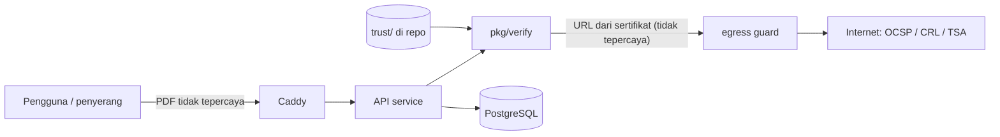

# Threat Model — PDF Signature Verifier

| | |
|---|---|
| **Status** | Draft v0.1 |
| **Metode** | STRIDE per komponen + daftar serangan PDF yang dikenal |
| **Terakhir diperbarui** | 2026-10-24 |
| **Ditinjau ulang** | Setiap akhir fase, dan setiap ada fitur yang menambah input atau akses keluar baru |

Threat model ini punya dua sisi:

1. **Ancaman terhadap layanan** — penyerang menyerang server, VM, atau data pengguna.
2. **Ancaman terhadap kebenaran verdict** — penyerang membuat PDF yang dinyatakan valid padahal sudah dimanipulasi. Ini kegagalan paling mahal, karena menyangkut fungsi utama produk.

---

## 1. Aset

| Aset | Kenapa penting |
|---|---|
| Kebenaran verdict | Satu "lolos palsu" merusak kepercayaan pada seluruh produk |
| Dokumen yang diunggah | Berisi data pribadi (UU PDP); bocor = insiden serius |
| Trust store | Root CA palsu = semua verifikasi bisa dipalsukan |
| API key dan kuota | Penyalahgunaan = biaya dan penolakan layanan |
| VM dan jaringan internal | Titik masuk ke layanan lain milik pemilik |
| Reputasi laporan | Laporan palsu yang mengaku dari layanan ini |

## 2. Batas kepercayaan

- **Semua isi PDF tidak tepercaya**, termasuk sertifikat dan URL di dalamnya.
- **Respons OCSP/CRL/TSA tidak tepercaya** sampai diverifikasi tanda tangannya.
- **Trust store tepercaya** hanya karena dikurasi lewat review dan dicek fingerprint-nya.

## 3. Ancaman terhadap kebenaran verdict

Serangan PDF yang dikenal (lihat riset publik di pdf-insecurity.org) dan kontrolnya:

| ID | Serangan | Cara kerja singkat | Kontrol | Status MVP |
|---|---|---|---|---|
| V-01 | **Incremental Saving Attack (ISA)** | Konten baru ditambahkan sebagai incremental update setelah tanda tangan; signature lama tetap valid secara kriptografis | `internal/diff` mengklasifikasikan setiap revisi setelah tanda tangan; perubahan kelas `CONTENT` → `MODIFIED_AFTER_SIGNING` | Ditangani |
| V-02 | **Signature Wrapping (SWA)** | `ByteRange` dimanipulasi agar rentang yang ditandatangani tidak mencakup konten yang ditampilkan | Validasi struktur `ByteRange`: mulai dari 0, celah tepat di `/Contents`, akhir rentang = akhir revisi | Ditangani |
| V-03 | **Universal Signature Forgery (USF)** | Nilai signature atau rujukan sertifikat dibuat kosong/null agar verifier lemah menganggap valid | Setiap field wajib ada dan bertipe benar; nilai kosong = `FORMAT_FAILURE`, tidak pernah dilewati | Ditangani |
| V-04 | **Shadow attack (hide)** | Konten disembunyikan di bawah objek yang sudah ditandatangani, lalu "dibuka" lewat update kecil yang tampak sah | Update yang mengubah objek halaman ditandai `CONTENT`; deteksi penuh butuh render | Sebagian (P1) |
| V-05 | **Shadow attack (replace)** | Objek font/XObject diganti lewat update yang tampak seperti form fill | Klasifikasi konservatif: penggantian resource = `CONTENT` | Sebagian (P1) |
| V-06 | **Shadow attack (hide-and-replace)** | Dokumen menyiapkan dua versi konten sebelum ditandatangani | Butuh perbandingan render antar-revisi | P1 |
| V-07 | Sertifikat dari CA tidak tepercaya | Penyerang membuat CA sendiri | Rantai harus berakhir di trust store; selain itu `NO_CERTIFICATE_CHAIN_FOUND` | Ditangani |
| V-08 | Sertifikat dicabut | Kunci penanda tangan bocor lalu dicabut | OCSP/CRL; tidak bisa cek = `INDETERMINATE` | Ditangani |
| V-09 | `signingTime` dimundurkan | Penanda tangan mengklaim waktu ketika sertifikat masih berlaku | Waktu hanya terpercaya dari timestamp RFC 3161; tanpa itu laporan menandai `claimed` | Ditangani |
| V-10 | Algoritma lemah | Signature MD5/SHA-1 atau RSA kecil yang bisa dipalsukan | Daftar algoritma yang diterima; di luar itu `CRYPTO_CONSTRAINTS_FAILURE` | Ditangani |
| V-11 | Respons OCSP palsu atau replay | Penyerang di jaringan membalas "good" | Tanda tangan respons OCSP diverifikasi; cek `thisUpdate`/`nextUpdate` dan nonce bila didukung | Ditangani |
| V-12 | Parser differential | Verifier dan viewer menafsirkan PDF berbeda (misalnya dua xref yang saling bertentangan) | Struktur ambigu (objek duplikat, xref bertentangan, data setelah `%%EOF` terakhir) dilaporkan; status minimal `INDETERMINATE` | Ditangani sebagian, perlu corpus |
| V-13 | QR code palsu | Dokumen punya QR menuju halaman palsu, tanpa tanda tangan | Produk tidak memakai QR sebagai bukti; dokumen tanpa tanda tangan = `NO_SIGNATURE` | Ditangani (di luar scope verifikasi QR) |

**Prinsip:** ketika ragu, tandai. False positive (peringatan berlebihan) jauh lebih murah daripada false negative.

## 4. Ancaman terhadap layanan (STRIDE)

### 4.1 Upload dan parser

| STRIDE | Ancaman | Kontrol |
|---|---|---|
| D | PDF bom: objek rekursif, kompresi bertingkat, ribuan objek | Batas ukuran 20 MiB, batas objek, batas kedalaman rekursi, batas rasio dekompresi, timeout 15 detik via `context` |
| D | Ribuan field tanda tangan | Maksimal 50 tanda tangan diproses; sisanya dilaporkan |
| D | Banyak request paralel menghabiskan RAM | Worker pool berukuran tetap; antrean dengan timeout 2 detik lalu `503` |
| T/E | Bug memori atau panic pada input aneh | Go memory-safe; fuzzing wajib; `recover()` per request; tidak ada `unsafe` atau cgo di parser |
| I | Dokumen tertulis ke disk atau log | Proses di memori; log hanya hash; container `read_only`; review untuk setiap pemanggilan `os.Create*` |

### 4.2 Akses keluar (OCSP, CRL, TSA)

| STRIDE | Ancaman | Kontrol |
|---|---|---|
| I/E | **SSRF**: URL AIA/CDP menunjuk ke `169.254.169.254`, `localhost`, atau IP privat | Egress guard: hanya http/https, port 80/443, tolak IP privat/loopback/link-local/CGNAT setelah resolve, dial ke IP hasil resolve |
| I/E | **DNS rebinding**: nama domain berganti IP antara cek dan koneksi | Resolve sekali, dial langsung ke IP yang sudah dicek |
| D | Respons sangat besar atau lambat | Batas ukuran (OCSP 64 KiB, CRL 10 MiB), timeout 5 detik, maksimal 2 redirect |
| D | Amplifikasi: satu PDF memicu ratusan request keluar | Batas jumlah URL unik per verifikasi (misalnya 20); cache per URL |
| I | Kebocoran informasi ke pihak luar | Request hanya berisi data yang wajib menurut protokol (serial/issuer hash) |

### 4.3 API dan autentikasi

| STRIDE | Ancaman | Kontrol |
|---|---|---|
| S | API key bocor atau ditebak | Key acak 32 byte, disimpan sebagai SHA-256, ditampilkan sekali, bisa dirotasi/dicabut |
| D | Penyalahgunaan endpoint publik | Rate limit per IP (anonim) dan per key; Caddy sebagai lapisan pertama |
| R | Pengguna menyangkal pernah memverifikasi | Log verifikasi dengan `verification_id`, hash dokumen, waktu (tanpa isi) |
| T | Laporan hasil dipalsukan (screenshot/HTML diedit) | Laporan memuat `verification_id` + hash yang bisa dicek ulang; P2: laporan ditandatangani server |

### 4.4 Trust store dan supply chain

| STRIDE | Ancaman | Kontrol |
|---|---|---|
| T | Root CA palsu disisipkan ke `trust/` | Manifest dengan SHA-256 dan sumber; perubahan lewat PR; loader menolak start jika fingerprint tidak cocok |
| T | Dependensi Go berbahaya atau rentan | `go.sum`, `govulncheck` di CI, dependensi minimal, Dependabot |
| T | Image container rentan | Base image distroless, Trivy scan di CI, rebuild berkala |
| E | Secret deploy bocor | Secret di GitHub Secrets; SSH key khusus deploy dengan akses terbatas |

### 4.5 VM dan hosting

| STRIDE | Ancaman | Kontrol |
|---|---|---|
| E | Akses SSH tidak sah | Key-only, root login mati, firewall hanya 22/80/443, fail2ban |
| E | Container escape ke host | Non-root, `cap_drop: ALL`, `no-new-privileges`, filesystem read-only |
| I | Layanan lain di VM yang sama terekspos | Jaringan Docker terpisah per project; `/metrics` tidak dipublikasikan |
| D | VM gratis berakhir mendadak | Semua konfigurasi di repo, backup DB di luar VM |

## 5. Ancaman yang diterima (accepted risks)

- **Shadow attack tingkat lanjut (V-04 s.d. V-06)** belum dideteksi penuh di MVP. README menyatakan batasan ini secara eksplisit.
- **Trust store hanya sebaik sumbernya.** Jika PSrE sendiri dibobol, verifier tidak bisa mendeteksinya.
- **Laporan HTML di MVP tidak ditandatangani.** Keasliannya hanya bisa dicek lewat `verification_id` selama data retensi masih ada.

## 6. Checklist review keamanan per PR

- [ ] Ada input baru dari dokumen? → batas ukuran/jumlah/kedalaman sudah ada, dan fuzz target diperbarui.
- [ ] Ada akses jaringan baru? → lewat `internal/egress`.
- [ ] Ada log baru? → tidak memuat isi dokumen, nama penanda tangan, atau secret.
- [ ] Ada jalur baru yang bisa menghasilkan `TOTAL-PASSED`? → ada test yang membuktikan semua syarat dicek.
- [ ] Ada dependensi baru? → alasan tertulis, `govulncheck` bersih.
